# Segmentacja klientów metodą K-means

Projekt zaliczeniowy z przedmiotu *Eksploracja danych*: kompletna, powtarzalna eksploracja danych
transakcyjnych sklepu internetowego (UCI Online Retail) – od danych surowych, przez kontrolę jakości
i analizę eksploracyjną, po segmentację klientów algorytmem K-means i prezentację wyników w aplikacji Streamlit.

**Aplikacja:** _link zostanie uzupełniony po wdrożeniu_ (instrukcja wdrożenia i lokalnego uruchomienia poniżej).

## Spis treści

1. [Cel projektu](#cel-projektu)
2. [Dane](#dane)
3. [Uruchomienie](#uruchomienie)
4. [Struktura repozytorium](#struktura-repozytorium)
5. [Kontrola jakości i czyszczenie](#kontrola-jakości-i-czyszczenie)
6. [Analiza eksploracyjna](#analiza-eksploracyjna)
7. [Cechy klientów](#cechy-klientów)
8. [K-means: porównanie wartości k](#k-means-porównanie-wartości-k)
9. [Charakterystyka segmentów](#charakterystyka-segmentów)
10. [Wnioski](#wnioski)
11. [Ograniczenia](#ograniczenia)
12. [Najważniejsze decyzje analityczne](#najważniejsze-decyzje-analityczne)
13. [Testy](#testy)

## Cel projektu

**Główne pytanie:** czy na podstawie zachowań zakupowych można wyróżnić interpretowalne segmenty klientów?

Pytania pomocnicze:

1. Jak różnią się klienci pod względem częstotliwości i wartości zakupów?
2. Ile segmentów jest uzasadnione w świetle wybranych metryk i interpretacji?
3. Czym charakteryzują się uzyskane segmenty i jakie są ograniczenia wnioskowania?

**Krótka odpowiedź:** tak – klienci dzielą się na cztery czytelne segmenty (najlepsi, stali, nowi i okazjonalni,
uśpieni), ale ich granice są umowne: klienci tworzą kontinuum zaangażowania, a K-means dzieli je na części
(silhouette 0,38).

## Dane

| | |
|---|---|
| **Źródło** | [UCI Machine Learning Repository – Online Retail](https://archive.ics.uci.edu/dataset/352/online+retail) (Chen, 2015, [doi:10.24432/C5BW33](https://doi.org/10.24432/C5BW33)), licencja CC BY 4.0 |
| **Opis** | wszystkie transakcje brytyjskiego sklepu internetowego z upominkami; wielu klientów to hurtownicy |
| **Zakres czasowy** | 01.12.2010 – 09.12.2011 |
| **Jednostka obserwacji** | pozycja faktury (produkt na fakturze); w segmentacji – **klient** |
| **Rozmiar** | 541 909 wierszy, 8 kolumn; 25 900 faktur, 4 372 klientów, 4 070 kodów produktów, 38 krajów |

| Kolumna | Znaczenie |
|---|---|
| `InvoiceNo` | numer faktury (6 cyfr); prefiks `C` oznacza fakturę anulującą |
| `StockCode` | kod produktu; kody specjalne (np. `POST`, `M`, `D`) to pozycje nietowarowe |
| `Description` | nazwa produktu |
| `Quantity` | liczba sztuk; wartości ujemne to anulowania, zwroty i korekty |
| `InvoiceDate` | data i godzina wystawienia faktury |
| `UnitPrice` | cena jednostkowa w GBP |
| `CustomerID` | identyfikator klienta |
| `Country` | kraj klienta |

Kopia zbioru w formacie Parquet (3,6 MB) znajduje się w [`data/`](data/README.md) – licencja CC BY 4.0
pozwala ją udostępniać. Funkcja `wczytaj_dane()` potrafi odtworzyć ją z oryginalnego pliku XLSX pobieranego z UCI.

## Uruchomienie

Wymagany Python 3.13.

```bash
python -m venv .venv
.venv\Scripts\activate          # Windows
source .venv/bin/activate       # Linux / macOS
pip install -r requirements.txt
```

| Zadanie | Polecenie |
|---|---|
| testy | `pytest` |
| aplikacja | `streamlit run app.py` (otwiera się pod adresem <http://localhost:8501>) |
| notebook z analizą | `pip install -r requirements-dev.txt`, a następnie `jupyter nbconvert --to notebook --execute --inplace notebooks/analiza.ipynb` |
| odtworzenie danych ze źródła | usuń `data/online_retail.parquet` – przy następnym uruchomieniu dane zostaną pobrane z UCI |

Wszystkie wyniki są odtwarzalne: K-means ma ustawione `random_state = 42` i `n_init = 10`, a próby
bootstrapowe używają tego samego ziarna.

### Wdrożenie

* **Render** – repozytorium zawiera plik [`render.yaml`](render.yaml) (usługa *Web Service*, plan darmowy).
  W panelu Render: *New → Blueprint*, wskazać repozytorium. Aplikacja startuje poleceniem
  `streamlit run app.py --server.port $PORT --server.address 0.0.0.0`. Darmowy plan ma 512 MB pamięci;
  aplikacja zajmuje ok. 400–450 MB, dlatego po wczytaniu danych przechowuje tylko zestawienia, a nie pełne transakcje.
* **Streamlit Community Cloud** (alternatywa z większym limitem pamięci) – *Create app*, repozytorium,
  gałąź `main`, plik `app.py`, w ustawieniach zaawansowanych Python 3.13.

## Struktura repozytorium

```
segmentacja-klientow/
├── app.py                    # aplikacja Streamlit
├── analiza/                  # cała logika – ta sama w notebooku, aplikacji i testach
│   ├── wczytanie.py          # pobranie, wczytanie i opis zbioru
│   ├── czyszczenie.py        # kontrola jakości, reguły czyszczenia, dziennik decyzji
│   ├── cechy.py              # tabela cech RFM, przekształcenia, skalowanie
│   ├── segmentacja.py        # K-means, porównanie k, stabilność, profile segmentów
│   ├── eda.py                # zestawienia do analizy eksploracyjnej
│   └── wykresy.py            # wykresy (matplotlib) używane w notebooku i aplikacji
├── tests/                    # testy pytest (53 testy)
├── notebooks/analiza.ipynb   # pełna analiza z komentarzami
├── figures/                  # wykresy zapisane przez notebook
├── data/                     # kopia zbioru (CC BY 4.0) i opis pochodzenia
├── requirements.txt          # zależności aplikacji i testów
├── requirements-dev.txt      # dodatkowe pakiety do uruchamiania notebooka
├── render.yaml               # konfiguracja wdrożenia na Render
└── .github/workflows/        # uruchamianie testów w GitHub Actions
```

## Kontrola jakości i czyszczenie

Sprawdzono typy, braki, duplikaty oraz wartości niedozwolone i nietypowe (`analiza/czyszczenie.py`).
Każda reguła czyszczenia jest osobną funkcją, która nie modyfikuje danych wejściowych i zapisuje wpis
w **dzienniku decyzji**:

| Krok | Działanie | Liczba obserwacji | Wiersze po | Uzasadnienie |
|---|---|---:|---:|---|
| pełne duplikaty | usunięcie | 5 268 | 536 641 | ta sama faktura, produkt, ilość, cena i minuta – podwójny zapis |
| brak `CustomerID` | usunięcie | 135 037 | 401 604 | jednostką analizy jest klient |
| ilość ≤ 0 poza fakturami `C` | usunięcie | 0* | 401 604 | korekty magazynowe (np. towar uszkodzony), nie zachowanie klienta |
| cena ≤ 0 | usunięcie | 40 | 401 564 | gratisy i korekty bez wartości zakupu |
| pozycje nietowarowe | usunięcie | 1 905 | 399 659 | opłaty pocztowe i bankowe, rabaty, korekty ręczne (do 38 970 GBP) |
| anulowania (`C`) | oznaczenie | 8 506 | 399 659 | **zostają**: pomniejszają wartość netto, nie liczą się jako zamówienia |
| klienci bez zakupu netto | wyłączenie z segmentacji | 42 klientów | 4 320 klientów | anulowania równoważą lub przewyższają zakupy |

\* wszystkie 1 336 takich wierszy w danych surowych nie miało identyfikatora klienta i odpadło w poprzednim kroku.

| Problem | Przed | Po |
|---|---:|---:|
| wiersze | 541 909 | 399 659 |
| pełne duplikaty | 5 268 | 0 |
| brak `CustomerID` | 135 080 | 0 |
| brak `Description` | 1 454 | 0 |
| wiersze faktur anulujących | 9 288 | 8 506 |
| `UnitPrice` = 0 / < 0 | 2 515 / 2 | 0 / 0 |
| nietypowy format `InvoiceNo` (prefiks `A`) | 3 | 0 |
| pozycje nietowarowe | 2 912 | 0 |
| faktury / klienci | 25 900 / 4 372 | 21 785 / 4 362 |

**Wartości skrajne nie są usuwane automatycznie.** Największe pozycje (80 995 i 74 215 sztuk) zostały
anulowane identycznymi fakturami `C` 12 i 16 minut później i w ujęciu netto się znoszą. Duzi klienci
(np. 278 778 GBP zakupów netto) to rzeczywiści odbiorcy hurtowi – ich wpływ ogranicza transformacja
logarytmiczna cech, a nie usunięcie.

## Analiza eksploracyjna

Pełna analiza z komentarzem do każdego wykresu jest w [notebooku](notebooks/analiza.ipynb) i w aplikacji.

| Cecha (pozycje sprzedażowe) | Liczebność | Średnia | Odch. std | Q1 | Mediana | Q3 |
|---|---:|---:|---:|---:|---:|---:|
| `Quantity` [szt.] | 391 153 | 13,15 | 180,81 | 2 | 6 | 12 |
| `UnitPrice` [GBP] | 391 153 | 2,87 | 4,28 | 1,25 | 1,95 | 3,75 |
| `Wartosc` [GBP] | 391 153 | 22,34 | 310,93 | 4,95 | 11,90 | 19,80 |

| Cecha klienta | Liczebność | Średnia | Odch. std | Q1 | Mediana | Q3 | Maks. |
|---|---:|---:|---:|---:|---:|---:|---:|
| Recency [dni] | 4 320 | 93,1 | 100,1 | 18 | 51 | 143 | 374 |
| Frequency [zamówienia] | 4 320 | 4,26 | 7,65 | 1 | 2 | 5 | 206 |
| Monetary [GBP] | 4 320 | 1 914,27 | 8 303,78 | 299,05 | 650,42 | 1 610,46 | 278 778,02 |

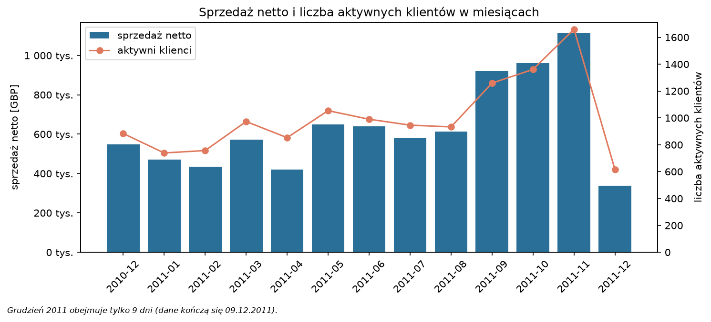

*Obserwacja:* od września do listopada 2011 sprzedaż netto rośnie z ok. 0,6 do 1,1 mln GBP miesięcznie,
a liczba aktywnych klientów z ok. 930 do 1 660. *Interpretacja:* sezon przedświąteczny – cecha Recency
liczona na 10.12.2011 faworyzuje klientów kupujących przed świętami.

| | |
|---|---|
| 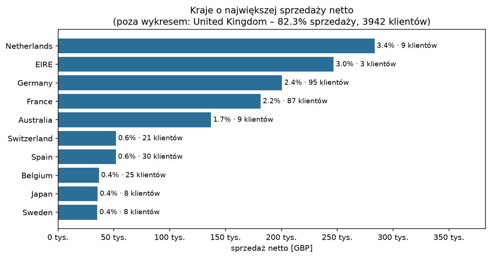 | 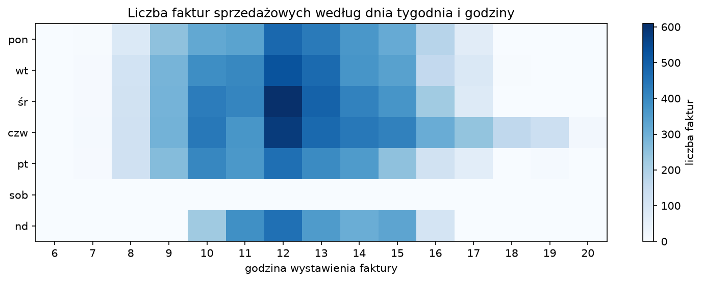 |
| Wielka Brytania to 82,3% sprzedaży i 90% klientów; Holandia (9 klientów) i Irlandia (3 klientów) dają 6,4% sprzedaży. | Brak faktur z soboty, zamówienia w godzinach pracy – rytm typowy dla klientów firmowych. |

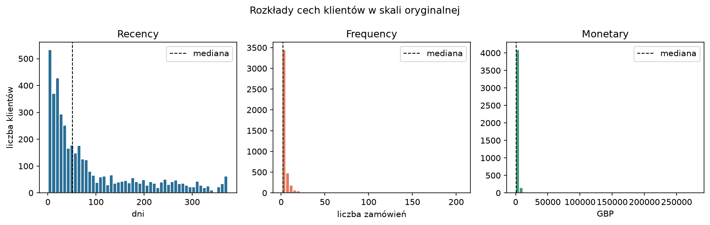

Frequency i Monetary mają skrajną prawostronną skośność (11,9 i 21,5), Recency – umiarkowaną (1,25).

| | |
|---|---|
| 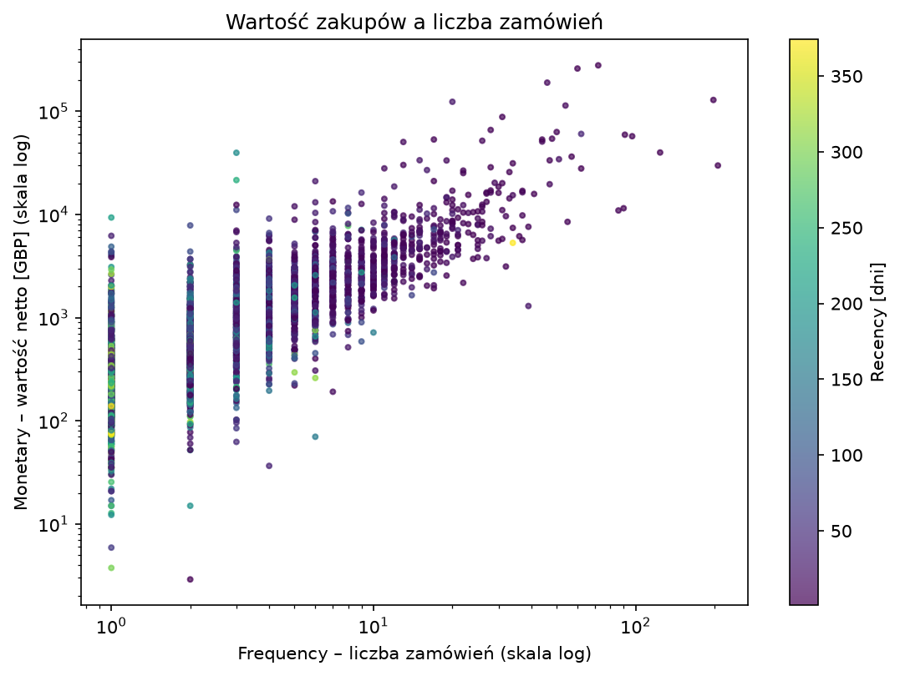 | 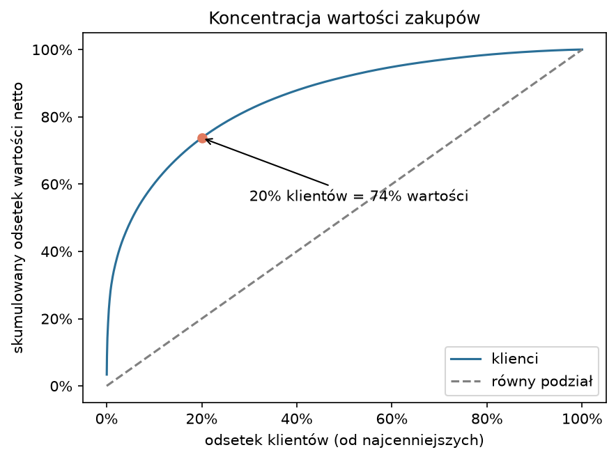 |
| Korelacja Spearmana F–M = 0,81; R–F = −0,56; R–M = −0,48. | 20% najcenniejszych klientów odpowiada za 74% wartości netto, 1% – za 30%. |

**Wnioski z EDA** (obserwacja → interpretacja):

1. 20% klientów generuje 74% wartości netto → klienci są bardzo zróżnicowani; warto wyodrębnić kluczową grupę,
   a cechy wartości trzeba przekształcić, żeby nie zdominowały segmentacji.
2. 34,6% klientów złożyło jedno zamówienie (mediana Frequency = 2) → duża część bazy to klienci jednorazowi
   lub nowi; przy rocznym oknie obserwacji nie da się odróżnić klienta nowego od utraconego po jednym zakupie.
3. F i M są silnie skorelowane i maleją wraz z Recency → segmenty będą się różnić głównie ogólnym poziomem
   aktywności; trzy cechy nie są niezależne.
4. 90% klientów pochodzi z Wielkiej Brytanii → wnioski opisują przede wszystkim rynek brytyjski.

## Cechy klientów

Transakcje zostały zagregowane do tabeli, w której jeden wiersz to jeden klient (`analiza/cechy.py`):

| Cecha | Definicja | Uzasadnienie |
|---|---|---|
| **Recency** | dni od dnia ostatniego zakupu do daty odniesienia **10.12.2011** (dzień po ostatniej transakcji) | im mniej dni, tym klient bardziej aktywny |
| **Frequency** | liczba **unikalnych faktur sprzedażowych** | jedna faktura = jedno zamówienie; liczenie pozycji zawyżałoby częstotliwość klientom kupującym wiele produktów naraz |
| **Monetary** | wartość zakupów **netto** w GBP (sprzedaż minus anulowania i zwroty) | wartość faktycznie pozostawiona w sklepie |

* **Brak podwójnego liczenia:** suma Monetary (8 265 476,93 GBP) jest równa wartości netto wszystkich transakcji,
  a suma Frequency (18 402) – liczbie faktur sprzedażowych; tabela ma dokładnie jeden wiersz na klienta.
* **Wybór cech:** RFM bezpośrednio odpowiada na pytanie badawcze i jest łatwy do interpretacji. Kraj nie jest cechą
  segmentacji (90% klientów z jednego kraju, zmienna kategoryczna nie pasuje do odległości euklidesowej).
* **Braki i wartości skrajne:** 42 klientów bez dodatniej wartości netto wyłączono z segmentacji (wpis w dzienniku).
  Frequency i Monetary przekształcono `log1p` (skośność spada z 11,9 do 1,2 i z 21,5 do 0,37), Recency zostaje
  w dniach. Nikogo nie usunięto z powodu wartości skrajnych.
* **Skalowanie:** K-means liczy odległości euklidesowe, więc bez skalowania o wyniku decydowałaby cecha o największym
  rozrzucie – po transformacji wariancja Recency (ok. 10 000 dni²) stanowiłaby 99,98% sumy wariancji.
  `StandardScaler` sprowadza każdą cechę do średniej 0 i odchylenia 1; jest dopasowany **wyłącznie** do 4 320 klientów
  użytych w segmentacji.

## K-means: porównanie wartości k

`sklearn.cluster.KMeans(n_clusters=k, n_init=10, random_state=42)` na przekształconych i przeskalowanych cechach.
Silhouette liczono na pełnym zbiorze 4 320 klientów (próbkowanie nie było potrzebne; funkcja `porownaj_k` umożliwia
liczenie na odtwarzalnej próbie). Stabilność to średni skorygowany indeks Randa (ARI) między podziałem z pełnych
danych a podziałami modeli dopasowanych do 20 prób bootstrapowych.

| k | Inercja | Spadek inercji | Silhouette | Davies–Bouldin | Najmniejszy klaster | Stabilność (ARI) |
|---:|---:|---:|---:|---:|---:|---:|
| 2 | 6 836 | – | 0,406 | 0,916 | 1 825 (42,2%) | 0,965 |
| 3 | 4 270 | −37,5% | **0,415** | **0,826** | 978 (22,6%) | **0,976** |
| **4** | 3 211 | −24,8% | 0,381 | 0,855 | 546 (12,6%) | 0,935 |
| 5 | 2 732 | −14,9% | 0,344 | 0,941 | 314 (7,3%) | 0,949 |
| 6 | 2 367 | −13,4% | 0,331 | 0,977 | 286 (6,6%) | 0,868 |
| 7 | 2 139 | −9,6% | 0,301 | 1,017 | 200 (4,6%) | 0,693 |
| 8 | 1 937 | −9,4% | 0,300 | 1,004 | 169 (3,9%) | 0,807 |

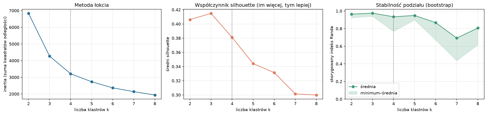

**Wybór k = 4** (a nie automatycznie maksimum metryki, które wskazuje k = 3):

1. **Metryki bliskie optimum** – silhouette 0,381 (o 0,034 mniej niż dla k = 3), Davies–Bouldin 0,855, ARI 0,935;
   k = 4 leży jeszcze w obszarze „łokcia” (od k = 5 spadki inercji < 15%, od k = 6 spada stabilność).
2. **Interpretacja** – przy k = 3 środkowy segment obejmuje 47% klientów i łączy stałych klientów (mediana
   4 zamówienia, 1 298 GBP) z jednorazowymi (1 zamówienie, 336 GBP); k = 4 rozdziela te grupy i oddziela najlepszych
   klientów od stałych.
3. **Liczebność** – najmniejszy segment ma 546 klientów; k = 5 dzieli najlepszych i stałych na dwa poziomy przy
   wyraźnie gorszych metrykach (silhouette 0,344, Davies–Bouldin 0,941).

**Wrażliwość na przygotowanie cech** – bez transformacji silhouette dla k = 2 wynosi aż 0,90, ale mniejszy klaster
liczy 22 klientów (0,5%): K-means tylko odcina skrajnych klientów od reszty. Winsoryzacja 1–99% daje silhouette
0,52–0,65 przy klastrach liczących 1–8% klientów.

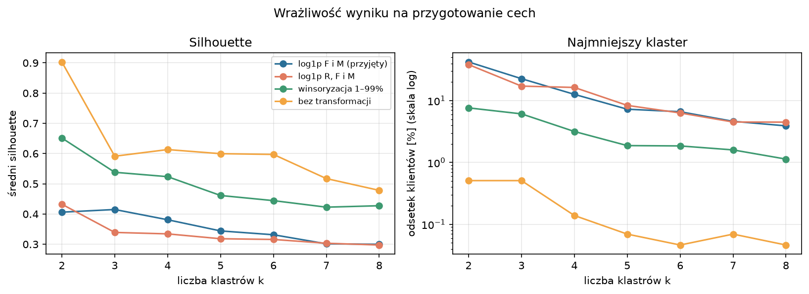

**Ograniczenia kryteriów:** inercja maleje monotonicznie z k, więc „łokieć” jest ocenny; silhouette i K-means zakładają
zwarte, wypukłe klastry podobnej wielkości, a przy kontinuum klientów silhouette jest umiarkowany dla każdego k;
obie miary zależą od transformacji i skalowania cech i żadna nie mierzy użyteczności biznesowej segmentów.

## Charakterystyka segmentów

Segmenty są numerowane od najwyższej mediany Monetary; statystyki w oryginalnych jednostkach.

| Segment | Klienci | Udział w wartości | Recency [dni] mediana / średnia | Frequency mediana / średnia | Monetary [GBP] mediana / średnia |
|---|---:|---:|---:|---:|---:|
| **0 – Najlepsi klienci** | 546 (12,6%) | 61,8% | 10 / 19,3 | 12 / 16,1 | 4 553 / 9 360 |
| **1 – Stali klienci** | 1 446 (33,5%) | 27,5% | 30 / 45,5 | 4 / 4,3 | 1 298 / 1 574 |
| **2 – Nowi i okazjonalni** | 1 388 (32,1%) | 6,4% | 51 / 58,8 | 1 / 1,5 | 336 / 381 |
| **3 – Uśpieni** | 940 (21,8%) | 4,3% | 256 / 259,8 | 1 / 1,4 | 282 / 376 |

| Segment | Opis | Możliwe działania |
|---|---|---|
| **Najlepsi klienci** | kupują często, niedawno i za duże kwoty; kupują od początku okresu (mediana stażu 361 dni), żaden nie jest jednorazowy; najpewniej odbiorcy hurtowi | utrzymanie: opiekun klienta, warunki współpracy |
| **Stali klienci** | regularni klienci o średniej wartości (staż 270 dni, 3–5 zamówień) | rozwój w stronę najlepszych: oferty uzupełniające |
| **Nowi i okazjonalni** | 56% zrobiło pierwszy zakup w ostatnich 90 dniach, 57% ma jedno zamówienie | zachęta do drugiego zakupu |
| **Uśpieni** | wszyscy bez zakupu od co najmniej 156 dni, 73% kupiło raz | tania reaktywacja albo brak działań |

| | |
|---|---|
| 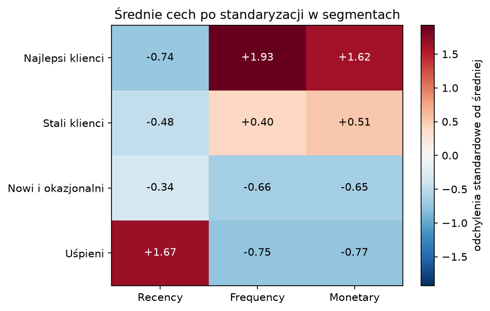 | 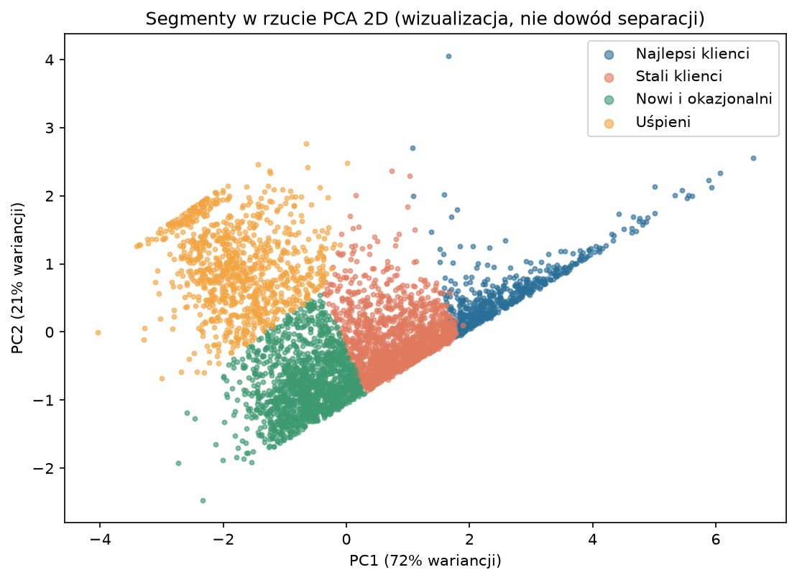 |
| Średnie standaryzowanych cech w segmentach. | Rzut PCA (93,7% wariancji) – **wizualizacja, nie dowód separacji** w pełnej przestrzeni cech. |

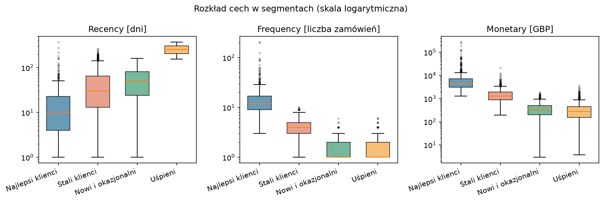

Segmenty „Nowi i okazjonalni” oraz „Uśpieni” mają podobne Frequency i Monetary – rozróżnia je Recency.

## Wnioski

1. *Obserwacja:* 12,6% klientów (segment „Najlepsi klienci”) generuje 61,8% wartości zakupów netto.
   *Interpretacja:* utrzymanie tej niewielkiej grupy ma największe znaczenie dla przychodów sklepu.
2. *Obserwacja:* segmenty „Nowi i okazjonalni” oraz „Uśpieni” to 53,9% klientów, ale tylko 10,7% wartości;
   dominują w nich klienci z jednym zamówieniem. *Interpretacja:* największym wyzwaniem jest drugi zakup;
   rozróżnienie nowych i uśpionych pozwala zaadresować ich innymi działaniami.
3. *Obserwacja:* segmenty różnią się przede wszystkim ogólnym poziomem aktywności (pierwsza składowa PCA wyjaśnia
   72% wariancji). *Interpretacja:* trzy cechy RFM niosą w praktyce ok. dwóch wymiarów informacji – „ile i jak często”
   oraz „jak dawno”.
4. *Obserwacja:* bez transformacji cech K-means wydziela pojedynczych skrajnych klientów przy bardzo wysokim
   silhouette. *Interpretacja:* przygotowanie cech wpływa na wynik bardziej niż wybór między sąsiednimi wartościami k.

## Ograniczenia

1. **Zakres danych** – jeden sklep i ok. 12 miesięcy; 25% transakcji bez identyfikatora klienta odrzucono.
   Wnioski dotyczą klientów obecnych w analizowanym zbiorze (zidentyfikowanych), a nie wszystkich klientów sklepu
   ani klientów w ogóle.
2. **Okno czasowe** – Recency zależy od daty odniesienia tuż po sezonie przedświątecznym; nie znamy historii sprzed
   grudnia 2010, więc „nowi” klienci mogą być klientami powracającymi.
3. **Definicje cech** – faktury anulujące nie są powiązane z oryginalnymi zamówieniami, więc zamówienie anulowane
   w całości nadal zwiększa Frequency; Monetary nie odróżnia klientów hurtowych od detalicznych.
4. **Metoda** – K-means zakłada sferyczne klastry podobnej wielkości, a wynik zależy od transformacji i skalowania;
   segmenty są podziałem kontinuum, a nie naturalnie oddzielonymi grupami.

## Najważniejsze decyzje analityczne

**Dlaczego K-means wymaga skalowania cech?** Przypisuje klientów do najbliższego centroidu w sensie odległości
euklidesowej, więc cecha o największym rozrzucie liczbowym zdominowałaby wynik. Bez standaryzacji Recency
(wariancja ok. 10 000) odpowiadałaby za 99,98% sumy wariancji i segmentacja dzieliłaby klientów tylko według czasu
od ostatniego zakupu.

**Jak zmieniają się wyniki dla innego k?** Przy k = 3 segment najlepszych łączy się z częścią stałych, a stali
z jednorazowymi (47% klientów w jednym segmencie). Przy k = 5 najlepsi (546) dzielą się na 314 + 232, a stali
(1 446) na 715 + 731 – powstają dwa poziomy tych samych grup. Wybór k można zmienić w aplikacji.

**Dlaczego wysoki silhouette nie gwarantuje użytecznych segmentów?** Silhouette nagradza odseparowanie grup, a nie ich
przydatność. W danych skośnych najwyższy wynik (0,90) daje podział „22 skrajnych klientów kontra reszta”,
bezużyteczny biznesowo. Miara nie uwzględnia też liczebności ani interpretacji segmentów.

**Jak traktowano zwroty, braki identyfikatorów i obserwacje odstające?** Anulowania i zwroty (faktury `C`) zostały
w danych: pomniejszają Monetary, ale nie zwiększają Frequency. Wiersze bez `CustomerID` (25%) usunięto, bo nie da
się ich przypisać do klienta. Obserwacji odstających nie usuwano – ograniczono ich wpływ transformacją `log1p`;
wyłączono jedynie 42 klientów bez dodatniej wartości netto.

**Czy wnioski dotyczą klientów, czy klientów obecnych w zbiorze?** Wyłącznie zidentyfikowanych klientów jednego
sklepu w okresie 12.2010–12.2011. Nie wiadomo, czy klienci anonimowi zachowują się podobnie, a segmentacja innego
okresu lub sklepu mogłaby dać inne wyniki.

## Testy

53 testy `pytest` uruchamiane lokalnie (`pytest`) i automatycznie w GitHub Actions przy każdym pushu:

| Plik | Co sprawdza |
|---|---|
| `tests/test_czyszczenie.py` | brak modyfikacji danych wejściowych przez każdą regułę, poprawność reguł, zgodność dziennika decyzji z liczbą wierszy |
| `tests/test_cechy.py` | ręcznie policzone R, F, M; Frequency liczy faktury, a nie pozycje; Monetary netto; brak podwójnego liczenia; skalowanie |
| `tests/test_segmentacja.py` | liczba przypisań = liczba klientów, etykiety 0…k−1, powtarzalność przy stałym `random_state`, porządek segmentów |
| `tests/test_eda.py`, `tests/test_wczytanie.py` | zestawienia EDA, typy kolumn i opis zbioru |
| `tests/test_potok.py` | cały potok od surowych transakcji do tabeli klientów z segmentem (jak w aplikacji) |
